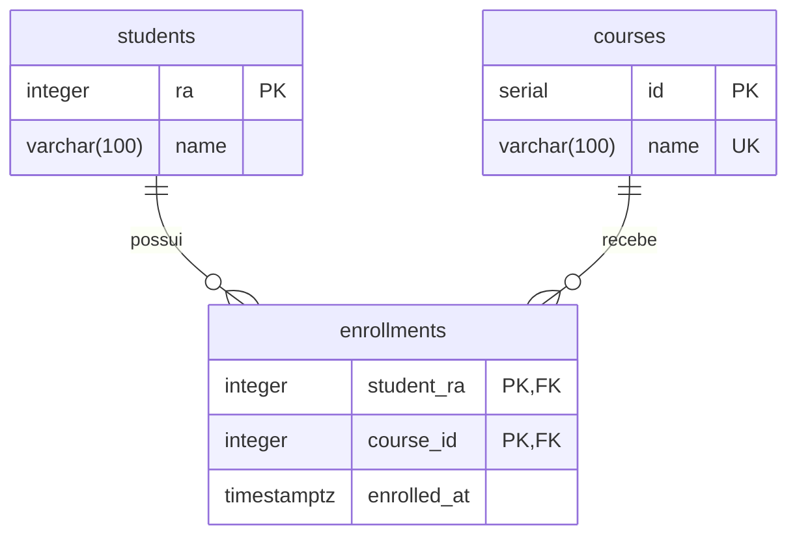

# Aula – API HTTP com recursos e princípios REST

## Descrição

Projeto didático para explorar a comunicação entre cliente e servidor por HTTP. A aplicação permite cadastrar alunos e disciplinas e registrar matrículas, usando uma API em Express com acesso direto ao PostgreSQL usando `pg`. Uma aplicação de página única (SPA), feita com HTML, CSS e JavaScript, permite enviar requisições e inspecionar as respostas no navegador.

O exemplo demonstra recursos identificados por URLs, representações JSON, métodos HTTP, códigos de status, validação, integridade dos dados e requisições independentes. A definição formal de REST também inclui hipermídia (HATEOAS), abordada como conceito na aula e não implementada neste exemplo.

## Estrutura de pastas e arquivos

```text
.
├── .env                           # Configuração utilizada na execução local do projeto
├── .env.example                   # Modelo das variáveis de ambiente
├── .gitignore                     # Arquivos ignorados pelo Git
├── compose.yml                    # Serviços, portas, rede, volume e healthchecks
├── README.md                      # Orientações para a aula
├── database/                      # Banco de dados PostgreSQL
│   ├── Dockerfile                 # Imagem com os scripts de inicialização
│   ├── init.sql                   # Criação das tabelas e restrições
│   └── seed.sql                   # 39 disciplinas, 3 alunos e 22 matrículas
├── front/                         # Cliente HTTP de página única
│   ├── Dockerfile                 # Imagem Nginx para servir a interface
│   ├── nginx.conf                 # Arquivos estáticos e proxy de /api para o servidor
│   ├── index.html                 # Estrutura da tela
│   ├── style.css                  # Estilos e adaptação para telas menores
│   └── app.js                     # Exemplos, envio via Fetch e exibição das respostas
└── server/                        # API HTTP em Express e TypeScript
    ├── Dockerfile                 # Compilação e execução
    ├── package.json               # Dependências e comandos npm
    ├── package-lock.json          # Versões das dependências
    ├── tsconfig.json
    ├── tsconfig.build.json
    ├── test/                      # Pasta a ser criada pelo aluno nesta atividade
    └── src/
        ├── main.ts                # Inicializa a aplicação e a porta HTTP
        ├── app.ts                 # Montagem da aplicação e middleware de erros
        ├── errors.ts              # Erros com status HTTP
        ├── validation.ts          # Funções puras de validação
        ├── database/
        │   ├── connection.ts      # Configura o Pool e define a interface Database
        │   ├── unique-violation.ts
        │   └── foreign-key-violation.ts
        └── modules/
            ├── students/          # *.routes.ts, *.service.ts e *.repository.ts
            ├── courses/           # *.routes.ts, *.service.ts e *.repository.ts
            └── enrollments/       # *.routes.ts, *.service.ts e *.repository.ts
```

As rotas recebem HTTP e retornam JSON; os serviços validam entradas e aplicam as regras; os repositórios executam SQL parametrizado com `pg`. Os serviços recebem seus repositórios pelo construtor, sem decorators ou contêiner de injeção de dependências. As interfaces permitem introduzir mocks, stubs e spies nas aulas seguintes.

`createApp(db)` monta o Express sem abrir uma porta ou criar um Pool. `database/connection.ts` configura e exporta o Pool; `main.ts` o fornece para a aplicação e inicia o servidor HTTP. Foram preservados os endpoints, os nomes JSON em camelCase (incluindo matrículas), os códigos de status e o healthcheck.

## Atividade — implementar os testes unitários do servidor

Você receberá o projeto sem a pasta `server/test/`. Sua tarefa é criar essa pasta e implementar os testes descritos abaixo, usando Jest, ts-jest e TypeScript, já configurados no projeto. Preserve o código de produção e as configurações fornecidas; escreva as verificações nos arquivos de teste.

Os testes devem ser independentes de PostgreSQL, Docker e `.env`. Nos serviços, substitua o repositório por dublês; nos repositórios, substitua `Database.query` por uma função simulada. Não abra conexões reais nem inicie o servidor HTTP. Os códigos `400`, `404` e `409` citados abaixo são valores de `statusCode` dos erros lançados pelos serviços, e não respostas obtidas por requisições HTTP.

### Organização da entrega

Crie os nove arquivos a seguir dentro de `server/test/`:

```text
test/
├── validation.test.ts
├── database/
│   ├── unique-violation.test.ts
│   └── foreign-key-violation.test.ts
└── modules/
    ├── courses/
    │   ├── courses.service.test.ts
    │   └── courses.repository.test.ts
    ├── students/
    │   ├── students.service.test.ts
    │   └── students.repository.test.ts
    └── enrollments/
        ├── enrollments.service.test.ts
        └── enrollments.repository.test.ts
```

Cada valor de uma lista de entradas deve ser exercitado individualmente; você pode usar `test.each`. Dê nomes que identifiquem o cenário e seu resultado esperado. Prepare os dados e as respostas simuladas em cada teste e limpe o histórico e as implementações dos mocks entre testes para evitar dependência da ordem de execução. Aguarde as operações assíncronas para que as asserções sejam executadas antes do término do teste.

### 1. Validações — `validation.test.ts`

Teste as funções exportadas por `src/validation.ts`. Para todas as entradas inválidas desta seção, verifique que a função lança um `HttpError` com `statusCode: 400`.

| Função | Entradas ou cenário | Resultado esperado |
| --- | --- | --- |
| `positiveInteger(value, "RA")` | `1` e `2147483647` | Retornar o próprio número, incluindo os limites permitidos. |
| `positiveInteger(value, "RA")` | `0`, `-1`, `1.5`, `NaN`, `Infinity`, `2147483648`, `"123"`, `null` e `undefined` | Rejeitar cada entrada. Uma string numérica não é aceita por esta função. |
| `parseId(value, "RA")` | `"1"` e `"2147483647"` | Converter a string para o número correspondente. |
| `parseId(value, "RA")` | `"1abc"`, `"1.2"`, `"1e2"`, `""`, `"-1"`, `"0"`, `"2147483648"` e o número `123` | Rejeitar cada entrada, sem aceitar conversões parciais, decimais ou notação exponencial. |
| `validateName(value)` | `"Ana"` e uma string com 100 letras `a` | Retornar o nome recebido. |
| `validateName(value)` | `""`, `"ab"`, `"   "`, `" a "`, uma string com 101 letras `a`, `123`, `null` e `undefined` | Rejeitar cada entrada; espaços não tornam um nome curto válido. |
| `validateBody(value)` | Objeto congelado com `Object.freeze`, contendo `name: "Ana"` | Retornar a mesma referência, sem modificar o objeto. |
| `validateBody(value)` | `null`, `undefined`, `[]`, `"Ana"` e `12` | Rejeitar cada entrada. |
| `validateBody(value)` | Objeto com `name: "Ana"` e `extra: true` | Aceitar campos extras e retornar a mesma referência sem alterar o objeto. |

### 2. Identificação de erros do banco — `database/*.test.ts`

Esses testes recebem objetos simulados; não é necessário provocar erros em um banco real.

- Em `unique-violation.test.ts`, verificar que `isUniqueViolation({ code: "23505" })` retorna `true`. Verificar que retorna `false` para cada uma das entradas: `null`, `undefined`, `"23505"`, `23503`, `{}` e `{ code: "outro" }`.
- Em `foreign-key-violation.test.ts`, verificar que `isForeignKeyViolation({ code: "23503" })` retorna `true`. Verificar que retorna `false` para cada uma das entradas: `null`, `undefined`, `"23505"`, `23503`, `{}` e `{ code: "outro" }`.

O código reconhecido deve estar diretamente na propriedade `code` do objeto; passar apenas uma string ou um número não caracteriza um erro PostgreSQL reconhecido.

### 3. Serviço de disciplinas — `courses.service.test.ts`

Instancie `CoursesService` com um repositório simulado que ofereça `create`, `findAll` e `findOne`.

1. **Criação válida:** fornecer `{ name: "Qualidade" }`, simular o registro criado e verificar o retorno. Confirmar que `repository.create` recebe os dados e é chamado exatamente uma vez.
2. **Criação inválida:** testar separadamente `null`, `{}` e `{ name: "A" }`. Esperar erro `400` e confirmar que `repository.create` não é chamado.
3. **Nome duplicado:** simular a rejeição de `repository.create` com `{ code: "23505" }` e esperar erro `409`.
4. **Listagem com stub:** preparar `findAll` para devolver uma lista conhecida. Verificar a lista retornada pelo serviço e uma única chamada ao método do repositório.
5. **Busca existente:** preparar um registro para `findOne(123)`, verificar o retorno e o argumento encaminhado ao repositório.
6. **Busca inexistente:** simular retorno `undefined` em `findOne(123)` e esperar erro `404`.
7. **Identificador inválido:** executar `findOne(0)`, esperar erro `400` e confirmar que o repositório não é consultado.
8. **Falhas inesperadas:** testar separadamente `create`, `findAll` e `findOne`. Fazer o método correspondente rejeitar com um objeto `Error` e verificar que o serviço propaga exatamente a mesma instância, sem traduzi-la para outro erro.
9. **Uso de spy:** criar um stub com métodos assíncronos e observar seu `findOne` com `jest.spyOn`. Executar a busca pelo serviço, conferir o registro retornado e verificar que o spy recebeu o identificador `1`.
10. **Campos extras:** criar com `{ name: "Qualidade", extra: true }` e confirmar que o repositório recebe somente `{ name: "Qualidade" }`.

Nesta seção, demonstre os três usos de dublês: stub para respostas predefinidas, mock para verificar interações e spy para observar um método de um objeto existente.

### 4. Serviço de alunos — `students.service.test.ts`

Instancie `StudentsService` com um repositório simulado.

1. **Criação válida:** enviar `{ ra: 123, name: "Ana" }`, verificar o registro retornado e os dados encaminhados a `repository.create`.
2. **RA inválido:** enviar `{ ra: 0, name: "Ana" }`, esperar erro `400` e verificar que `repository.create` não é chamado.
3. **RA duplicado:** simular `{ code: "23505" }` na criação e esperar erro `409`.
4. **Aluno inexistente:** simular `undefined` na busca pelo RA `123` e esperar erro `404`.
5. **Falha inesperada na criação:** simular um `Error` e verificar a propagação da mesma instância.
6. **Listagem:** simular uma lista de alunos, verificar o retorno e confirmar que `repository.findAll` é chamado exatamente uma vez, sem argumentos.
7. **Aluno existente:** simular um registro, verificar o retorno de `findOne(123)` e confirmar uma única chamada a `repository.findOne` com o RA `123`.

### 5. Serviço de matrículas — `enrollments.service.test.ts`

Instancie `EnrollmentsService` com um repositório simulado. Use registros com `studentRa`, `courseId` e `enrolledAt`; a data pode ser fixa para tornar os testes reproduzíveis.

1. **Criação válida:** enviar `{ studentRa: 123, courseId: 1 }`, verificar o registro retornado e confirmar que `repository.create` recebe os argumentos separados `123` e `1`, nessa ordem.
2. **Chave inválida:** testar separadamente `{ studentRa: 0, courseId: 1 }` e `{ studentRa: 123, courseId: 0 }`. Esperar erro `400` e confirmar que `repository.create` não é chamado.
3. **Referência inexistente:** simular `{ code: "23503" }` na criação e esperar erro `404`, representando aluno ou disciplina inexistente.
4. **Matrícula duplicada:** simular `{ code: "23505" }` na criação e esperar erro `409`.
5. **Busca inexistente:** simular `undefined` em `findOne(123, 1)`, esperar erro `404` e confirmar que os dois identificadores são encaminhados ao repositório na ordem correta.
6. **Falha inesperada na criação:** simular um `Error` e verificar a propagação da mesma instância.
7. **Listagem:** verificar a lista retornada e confirmar uma única chamada a `repository.findAll`, sem argumentos.
8. **Busca existente:** simular uma matrícula, verificar o retorno de `findOne(123, 1)` e confirmar uma única chamada a `repository.findOne` com ambos os identificadores.

### 6. Repositórios — `modules/*/*.repository.test.ts`

Teste `PgCourseRepository`, `PgStudentRepository` e `PgEnrollmentRepository` em seus respectivos arquivos. Injete um objeto com `query` simulado, respeitando a interface `Database`. Simule respostas no formato `{ rows: [...] }`.

Para **cada um dos três repositórios**, implemente os cenários:

1. **Criação:** `query` devolve uma linha; `create` retorna essa linha. Verificar uma única chamada a `query`, o comando de inserção, as colunas de `RETURNING` e o array de parâmetros na ordem correta.
2. **Listagem com registros:** `findAll` retorna as linhas simuladas. Verificar uma única chamada a `query`, as colunas selecionadas, o `ORDER BY` esperado e a ausência de um array de parâmetros.
3. **Listagem vazia:** quando `rows` é `[]`, `findAll` retorna `[]`.
4. **Busca existente:** `findOne` retorna a primeira linha simulada. Verificar uma única chamada a `query`, o filtro da busca e os identificadores no array de parâmetros.
5. **Busca inexistente:** quando `rows` é `[]`, `findOne` retorna `undefined`.
6. **Falhas do banco:** testar separadamente `create`, `findAll` e `findOne`, fazendo `query` rejeitar com um `Error`. Cada método deve propagar a mesma instância.

Use os contratos abaixo nas verificações de SQL e parâmetros:

| Repositório | Criação | Listagem | Busca |
| --- | --- | --- | --- |
| `PgCourseRepository` | Inserir `name` em `courses`, com `$1` e parâmetros `[name]`; retornar `id, name`. | Selecionar `id, name` de `courses`, com `ORDER BY id`. | Filtrar `id = $1`, com `[7]` ao buscar `findOne(7)`. |
| `PgStudentRepository` | Inserir `ra, name` em `students`, com `$1, $2` e parâmetros `[ra, name]`; retornar `ra, name`. | Selecionar `ra, name` de `students`, com `ORDER BY name`. | Filtrar `ra = $1`, com `[123]` ao buscar `findOne(123)`. |
| `PgEnrollmentRepository` | Inserir `student_ra, course_id` em `enrollments`, com `$1, $2` e parâmetros `[123, 7]` ao criar com esses identificadores. | Selecionar os campos da matrícula de `enrollments`, com `ORDER BY student_ra, course_id`. | Filtrar `student_ra = $1 AND course_id = $2`, com `[123, 7]` ao buscar `findOne(123, 7)`. |

Nas matrículas, tanto a inserção (`RETURNING`) quanto as consultas devem usar os aliases `student_ra AS "studentRa"`, `course_id AS "courseId"` e `enrolled_at AS "enrolledAt"`. Verifique que o registro retornado mantém esses nomes em camelCase e a data simulada. A ordenação é verificada no SQL enviado; o mock não executa a ordenação nem o comando no PostgreSQL.

Ao comparar SQL, normalize espaços e quebras de linha para que a formatação não cause falhas. Os valores devem ser enviados no array de parâmetros, separados do texto SQL, usando os marcadores `$1` e `$2` conforme a operação.

### Execução e critérios de conclusão

Com Node.js 24 instalado:

```powershell
cd server
npm ci
npm test
npm run test:coverage
npm run test:typecheck
npm run build
```

Entregue os nove arquivos com todos os cenários descritos, incluindo os casos individuais das listas e os erros de cada método. A referência contempla 106 casos quando cada entrada parametrizada é contada separadamente; a quantidade isolada não substitui a verificação dos comportamentos exigidos. Todos os testes, a checagem de tipos dos testes e a compilação devem passar. O comando `npm test` deve funcionar sem banco de dados disponível.

`npm run test:coverage` gera um relatório informativo, sem percentual mínimo obrigatório. O relatório HTML fica em `server/coverage/index.html`. A medição inclui todos os arquivos de aplicação, exceto `main.ts` e `database/connection.ts`, responsáveis pela inicialização e configuração do Pool. Os testes não verificam a execução do SQL em PostgreSQL real; essa integração continua como exercício separado.

Testes de rotas HTTP, montagem do Express, frontend e integração com PostgreSQL real não fazem parte desta entrega. Como extensão, os repositórios podem ser testados contra um banco exclusivo de testes, separado dos dados usados na aula.

Para executar a API localmente, inicie o banco com `docker compose up -d database`. Na pasta `server`, configure `DB_HOST=localhost`, `DB_PORT=5433` (ou a porta publicada escolhida) e `SERVER_PORT=3002` no ambiente, e execute `npm run dev`. Os scripts `start`, `start:prod` e `dev` carregam o `.env` da raiz com a opção nativa `--env-file=../.env` do Node.js. As variáveis já definidas no ambiente têm prioridade. No Docker, o Compose fornece as variáveis diretamente e o contêiner executa `node dist/main.js`. A execução completa com Compose continua disponível como descrito abaixo.

## Diagrama do banco de dados



Um aluno pode ter várias matrículas, e uma disciplina pode receber vários alunos. A chave primária composta de `enrollments` impede matricular o mesmo aluno duas vezes na mesma disciplina. As chaves estrangeiras impedem referências inexistentes e a exclusão de alunos ou disciplinas com matrículas vinculadas. Nomes de alunos podem se repetir; nomes de disciplinas são únicos.

O seed cadastra Ana Clara em 5 disciplinas, Bruno Henrique em 7 e Camila em 10. A data da matrícula é preenchida automaticamente pelo banco.

## Como reproduzir o exemplo

### 1. Preparar o ambiente

Instale o Docker com suporte ao Docker Compose e mantenha o mecanismo Docker em execução. Execute os comandos na pasta que contém `compose.yml`. Não é necessário instalar Node.js ou PostgreSQL no computador para executar pelo Compose.

Se ainda não houver um `.env`, copie o modelo. No PowerShell:

```powershell
Copy-Item .env.example .env
```

No Bash:

```bash
cp .env.example .env
```

Confira as variáveis do `.env`:

| Variável | Finalidade | Valor do modelo |
| --- | --- | --- |
| `DB_HOST` | Host do banco; no Compose, o servidor usa o serviço `database` | `database` |
| `DB_PORT` | Porta interna do PostgreSQL | `5432` |
| `DB_PORT_HOST` | Porta do banco publicada no computador | `5433` |
| `DB_NAME` | Nome do banco | `postgres` |
| `DB_USER` | Usuário do banco | `postgres` |
| `DB_PASSWORD` | Senha do banco para o exemplo local | `postgres` |
| `SERVER_PORT` | Porta interna da API | `3000` |
| `SERVER_PORT_HOST` | Porta da API publicada no computador | `3002` |
| `FRONT_PORT_HOST` | Porta da interface publicada no computador | `8080` |

O sufixo `_HOST` identifica portas publicadas no computador. Mantenha `DB_PORT=5432`, pois o exemplo usa a porta padrão do PostgreSQL. O Compose traduz as credenciais `DB_*` para as variáveis `POSTGRES_*` exigidas pela imagem do banco.

### 2. Construir e iniciar os contêineres

```bash
docker compose up -d --build
```

Esse comando constrói as imagens, cria e inicia os contêineres. O servidor aguarda o banco ficar saudável; o frontend aguarda o healthcheck do servidor.

Se as imagens já foram construídas com `docker compose build`, use `docker compose up -d`.

Confira o estado e acompanhe os logs:

```bash
docker compose ps
docker compose logs -f server database front
```

Use `Ctrl+C` para sair dos logs; os contêineres continuam em execução.

### 3. Acessar a aplicação

Com as portas do modelo:

| Endereço | Finalidade |
| --- | --- |
| http://localhost:8080 | Interface do laboratório |
| http://localhost:3002/api/students | Consulta direta à API |
| http://localhost:3002/health | Verificação da API: retorna `{"status":"ok"}` |
| `localhost:5433` | Conexão com o banco por uma ferramenta externa |

O endpoint `/health` verifica se a API responde; ele não consulta o banco. Ajuste os endereços caso tenha alterado as portas no `.env`.

O Nginx encaminha as chamadas `/api` da página para o Express pela rede do Compose. Mantenha o endereço base da tela como `http://localhost:8080`: assim, página e requisições usam a mesma origem. Abrir o HTML diretamente ou apontar para outra origem pode exigir configuração de CORS na API.

### 4. Encerrar a execução

```bash
docker compose down
```

O volume `aula3_database_data` preserva os dados. `init.sql` e `seed.sql` são executados, nessa ordem, apenas na primeira inicialização de um diretório de dados vazio. Reconstruir as imagens não reaplica esses scripts em um banco existente.

## Explicação sobre a tela

### Painel 01 — Requisição

- **Operação:** preenche o formulário com uma chamada de alunos, disciplinas ou matrículas. Há também exemplos de erros HTTP.
- **Endereço base:** origem para a qual a chamada será enviada; por padrão, utiliza o endereço da própria página.
- **Método:** definido pela operação selecionada (`GET` ou `POST`).
- **Caminho do recurso:** identifica a coleção ou o recurso, como `/api/students/258001`. O cliente verifica se o caminho suporta o método selecionado antes de enviar.
- **Corpo da requisição:** JSON enviado em `POST`. O campo fica desabilitado para `GET` neste cliente.
- **Enviar requisição:** executa a chamada. JSON inválido é identificado antes do envio.
- **Requisição preparada:** mostra método, URL e headers definidos pelo cliente. O navegador pode adicionar outros headers.

Selecionar um exemplo apenas preenche o formulário. A chamada acontece ao clicar em **Enviar requisição**. Operações `POST` alteram os dados reais do banco.

### Painel 02 — Resposta

- **Status HTTP:** apresenta o código retornado, destacando sucesso ou erro.
- **Metadados:** mostram duração observada pelo cliente, quantidade de bytes do corpo recebido e URL final. O tamanho não representa todo o tráfego HTTP.
- **Headers da resposta:** exibem os cabeçalhos acessíveis ao JavaScript, como `Content-Type`.
- **Corpo da resposta:** mostra o conteúdo recebido, formatando JSON para facilitar a leitura.

Os headers exibidos passam pelo proxy Nginx; headers restritos pelo navegador, como `Set-Cookie`, não ficam disponíveis via Fetch.

Respostas `400`, `404` e `409` são respostas HTTP e aparecem com seus headers e corpo. Uma falha de conexão é apresentada separadamente, sem inventar um status HTTP. O cliente limita a espera a 15 segundos.

### Roteiro de teste na aula

1. Escolha **Alunos · listar** e envie a requisição. Observe o status `200`, os headers e o array JSON.
2. Use **Alunos · criar** para cadastrar o RA `258099`. Observe `201`. Reenvie a chamada para observar `409` por RA duplicado.
3. Busque esse aluno e confira os dados retornados.
4. Crie uma disciplina e anote o `id` retornado.
5. Crie uma matrícula usando o RA do aluno e o ID da disciplina criada. Reenvie para observar `409` por matrícula duplicada.
6. Experimente **Erro 400 · dados inválidos** e **Erro 404 · aluno inexistente**. Compare os corpos e headers com os das respostas de sucesso.

Os exemplos baseados no seed pressupõem que seus registros ainda existem. Se o RA de teste já estiver cadastrado, use outro RA e ajuste as chamadas seguintes.


O corpo JSON pode conter campos extras. Cada serviço valida os campos necessários e envia somente esses campos ao repositório. A atividade abrange testes unitários de validação, serviços, repositórios e identificação de erros do banco. As rotas e a montagem do Express ficam fora do escopo e podem aparecer sem cobertura no relatório.
